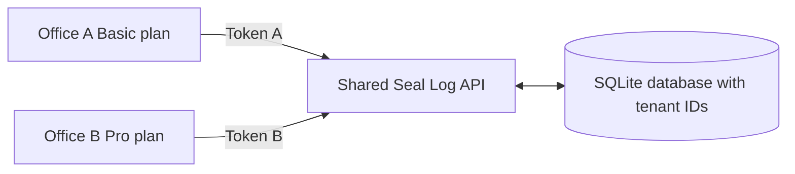

# Seal Log Design Brief

Mironov Egor, N4250c  
Cloud Computing Practical Work 5

## 1 Service idea

I plan to build a small SaaS called Seal Log for government offices. Staff can use it to record security seals on document cabinets, server cabinets and transport cases. It helps staff keep regular inspection results and seal replacement history in one place. An organization could pay for a higher limit on registered objects.

## 2 Workflow and records

An object is a cabinet or case that the organization wants to monitor.

1. Add an object with its name, location and first seal number.
2. View the object's record and inspect its current seal.
3. Save an inspection with a result: intact, broken or missing, and an optional note.
4. When the seal is replaced, save the new number and keep the old seal record.
5. View the current seal and the full inspection and replacement history.

The API will support these actions and listing the organization's objects.

| Record | Main fields |
|---|---|
| Tenant | ID, organization name, plan |
| Object | ID, tenant ID, name, location |
| Seal | ID, tenant ID, object ID, number, installation and removal dates |
| Inspection | ID, tenant ID, seal ID, date and time, result, note |

## 3 Shared application and tenant access

The prototype will use Python, Flask and SQLite. It will run in one Docker container in a Linux VM, with the database in a Docker volume. All test data will be synthetic.

A tenant is one customer organization. Office A and Office B will have different preconfigured API tokens. Each request sends its token in `Authorization: Bearer <token>`.

The server verifies the token and reads the tenant ID from the tenant table. It never trusts a tenant ID sent by the client.

Every operation on objects, seals and inspections checks the tenant ID. Lists contain only that tenant's records. A request for another tenant's record returns `404 Not Found` and cannot read or change it. A missing or invalid token returns `401 Unauthorized`.

## 4 Plans and limit

| Plan | Tenant | Maximum registered objects |
|---|---|---:|
| Basic | Office A | 5 |
| Pro | Office B | 20 |

Creating an object uses one place in the allowance. Before saving it, the server counts that tenant's objects and checks the plan limit. The count check and save happen in one database transaction.

At the limit, the server returns `403 Forbidden` with a message such as `Object limit reached (5).` No object is saved.

The allowance is the total number of registered objects. Inspections and seal replacements do not use extra places. Object deletion is outside the prototype scope. Plans will be configured in advance; no payment system is needed.

## 5 Acceptance checks

Each check starts with a fresh test database.

### Check 1 Normal use

**Starting conditions:** A has Basic, B has Pro. Both have valid tokens and no objects.

**Action:** As each tenant, create a cabinet with a seal, add an inspection, replace the seal and read the history. Use seal numbers A001 and A002 for A, and B001 and B002 for B. Request both object lists.

**Expected result:** Creation requests return `201 Created` and reads return `200 OK`. Both tenants complete the workflow. Each sees only its own object, the new seal and the saved history.

### Check 2 Tenant isolation

**Starting conditions:** B has created a cabinet with seal B001 and an inspection result of intact. B can read it. A has its own valid token.

**Action:** Using A's token and B's cabinet ID, try to read the cabinet and history, add an inspection and replace the seal. Then read the cabinet and history again using B's token.

**Expected result:** A receives `404 Not Found` without B's data. B receives `200 OK`. B's record and history remain unchanged.

### Check 3 Plan limit

**Starting conditions:** A and B have each successfully created five objects. A uses Basic and B uses Pro.

**Action:** Try to create a sixth object as A, then as B. Read both object lists.

**Expected result:** A receives `403 Forbidden` and `Object limit reached (5).` A still has five objects. B receives `201 Created` and now has six objects, within its limit of 20.
